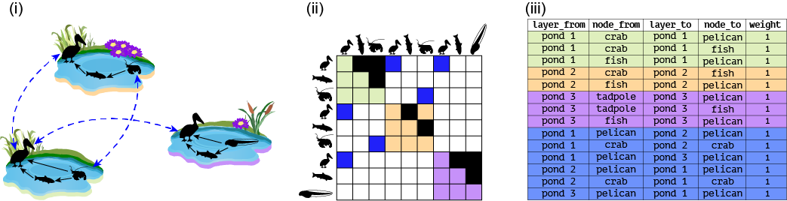
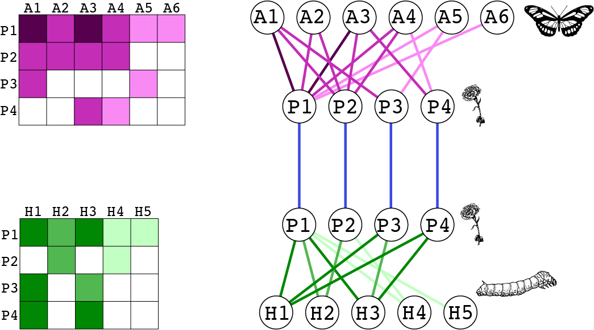

```{r setup, include=FALSE}
knitr::opts_chunk$set(echo = T, message=FALSE, warning=FALSE, cache=FALSE)
```

```{r message=FALSE, warning=FALSE}
# Change the source for library(emln) later
source('../R/create_multilayer_network.R')
source('../R/create_monolayer_object.R')
source('../R/list_to_matrix.R')
source('../R/matrix_to_list_bipartite.R')
source('../R/matrix_to_list_unipartite.R')

library(tidyverse)
# library(emln)
library(bipartite)
library(infomapecology)
library(magrittr)
```

# Monolayer

We provide examples with simulated toy networks and with real data to create an object of class `monolayer`. See help (`?monolayer`) to learn more about this class 

## Unipartite 

We start with a toy example. We generate a 3x3 matrix with random weighted interactions.

```{r monolayer_uni_1}
n <- 3
adjacency_matrix <- matrix(round(runif(n*n,1,5),0), ncol = n, dimnames = list(paste0("A", 1:n), paste0("A", 1:n)))

# Convert a matrix to a monolayer object
matrix_to_list_unipartite(adjacency_matrix, directed = TRUE)
```

Now let's see a toy example for converting a link list.

```{r monolayer_uni_2}
# Generate a data frame with random links
link_list_unipartite <- data.frame(from=c("A1", "A1", "A1", "A2", "A2", "A2", "A3", "A3","A3"), to=c("A1", "A2", "A3", "A1", "A2", "A3", "A1", "A2","A3"), weight=round(runif(n*n,1,5),0))

list_to_matrix(link_list_unipartite, directed = TRUE, bipartite = FALSE)
```

To illustrate working with real data we will use a binary directed marine food web from [Jacob, Ute, Aaron Thierry, Ulrich Brose, Wolf E. Arntz, Sofia Berg, Thomas Brey, Ingo Fetzer, et al. 2011. “The Role of Body Size in Complex Food Webs: A Cold Case.” In Advances in Ecological Research, edited by Andrea Belgrano, 45:181–223. Academic Press.](https://www.sciencedirect.com/science/article/pii/B9780123864758000058) Kongsfjorden is a glacial fjord on the northwest corner of the Svalbard archipelago. It is a 30 km open fjord with no marked sill at the entrance, and with a maximum depth exceeding 300 m. The network consists of 262 species with 1,544 feeding interactions. **Note the warning messges**; these are ok for this data set.

**These data are organized as a link list, so it is possible to include node attributes.**


```{r monolayer_uni_data_1}
# The data is included in the infomapecology package
data("kongsfjorden_links", package = 'infomapecology')
data("kongsfjorden_nodes", package = 'infomapecology')
nodes <- kongsfjorden_nodes %>%
  select(node_name=Species, node_id_original=NodeID, everything())

interactions <- kongsfjorden_links %>%
  select(from=consumer, to=resource) %>%
  mutate_if(is.factor, as.character) %>%
  mutate(weight=1)

monolayer_unipartite <- list_to_matrix(x=interactions, directed = T, bipartite = F, node_metadata = nodes)

head(monolayer_unipartite$nodes)

head(monolayer_unipartite$edge_list)
```

Now let's take the matrix we obtained as an example, and create a monolayer object from a matrix.

```{r monolayer_uni_data_2}
kongsfjorden_matrix <- monolayer_unipartite$mat
monolayer_unipartite <- matrix_to_list_unipartite(x = kongsfjorden_matrix, directed = T)
```


## Bipartite

We start with a toy example. We generate a random incidence matrix with dimensions P X A. Bipartite networks have two sets of nodes with no overlap between the sets.

```{r monolayer_bip_1}
# Case "Bipartite networks"
# 
P <- 4 # 4 rows
A <- 3 # 3 columns
incidence_matrix <- matrix(round(runif(P*A,1,5),0), ncol = A, dimnames = list(paste0("P", 1:P), paste0("A", 1:A)))

# Convert an matrix to an edge list for bipartite network
matrix_to_list_bipartite(incidence_matrix, group_names = c('A_set', 'P_set'))$edge_list
```

To demonstrate real data we use the incidence matrix olesen2002flores included in the bipartite package.

```{r monolayer_bip_2}
# create a monolayer object from a bipartite matrix
monolayer_bipartite <- matrix_to_list_bipartite(x = olesen2002flores, group_names = c('Pollinator', 'Plant'))

# What is included in the monolayer class object
names(monolayer_bipartite)

# The nodes in the network
monolayer_bipartite$nodes

# The link (edge) list
monolayer_bipartite$edge_list

# An igraph object is also created
monolayer_bipartite$igraph_object
```

We can also convert a link list to a monolayer object.

```{r monolayer_bip_3}
ll <- monolayer_bipartite$edge_list
monolayer_bipartite_2 <- list_to_matrix(ll, bipartite = T, group_names = c('Pollinator', 'Plant'))
```


## Function create_monolayer_object

This function is a wrapper for the `matrix_to_list_unipartite`, `matrix_to_list_bipartite`, and `list_to_matrix` functions. It is convenient because it automatically selects the input type.

```{r create_monolayer_object}
#Input is a link list
monolayer_unipartite <- create_monolayer_object(x=interactions, directed = T, bipartite = F, node_metadata = nodes)

# Input is a matrix
bipartite_monolayer <- create_monolayer_object(x = olesen2002flores, group_names = c('Pollinator', 'Plant'), bipartite = T)
```


# Multilayer


## Unipartite multilayer network


### Toy example

We start with a toy example using Fig. 1A from the paper shown below.




```{r emln_fig1A_1}
pond_1 <- matrix(c(0,1,1,0,0,1,0,0,0), byrow = T, nrow = 3, ncol = 3, dimnames = list(c('pelican','fish','crab'),c('pelican','fish','crab')))

pond_2 <- matrix(c(0,1,0,0,0,1,0,0,0), byrow = T, nrow = 3, ncol = 3, dimnames = list(c('pelican','fish','crab'),c('pelican','fish','crab')))

pond_3 <- matrix(c(0,1,1,0,0,1,0,0,0), byrow = T, nrow = 3, ncol = 3, dimnames = list(c('pelican','fish','tadpole'),c('pelican','fish','tadpole')))

layer_attrib <- tibble(layer_id=1:3,
                     layer_name=c('pond_1','pond_2','pond_3'),
                     location=c('valley','mid-elevation','uphill'))


# Create the ELL tibble with interlayer links.
interlayer <- tibble(layer_from=c('pond_1','pond_1','pond_1'),
                     node_from=c('pelican','crab','pelican'),
                     layer_to=c('pond_2','pond_2','pond_3'), 
                     node_to=c('pelican','crab','pelican'),
                     weight=1)

# This is a directed network so the links should go both ways, even though they are symmetric.
interlayer_2 <- interlayer[,c(3,4,1,2,5)]
names(interlayer_2) <- names(interlayer)
interlayer <- rbind(interlayer, interlayer_2)


# This example is commented out because it cannot run. It fails because we provide interlayer links, which include layer names, but not the layer attributes that contain the layer names
# multilayer <- create_multilayer_network(list_of_layers = list(pond_1, pond_2, pond_3),
#                           interlayer_links = interlayer,
#                           bipartite = F,
#                           directed = T)

# When layer attributes are not included they are auto-generated
multilayer <- create_multilayer_network(list_of_layers = list(pond_1, pond_2, pond_3), 
                                        bipartite = F, 
                                        directed = T)

multilayer$layer_attributes

# An example with layer attributes and interlayer links
multilayer <- create_multilayer_network(list_of_layers = list(pond_1, pond_2, pond_3),
                          interlayer_links = interlayer,
                          layer_attributes = layer_attrib,
                          bipartite = F,
                          directed = T)
```

## Class `multilayer`
 The resulting `multilayer` class includes the following tables:
 
* **nodes:** Physical nodes. First column is a unique node id. Node attributes are included if provided as input.
* **layers:** Information on layers.
* **extended:** An extended link list of the format `layer_from node_from layer_to node_to weight`. All nodes and layers are identified by names.
* **extended_ids:** An extended link list of the format `layer_from node_from layer_to node_to weight`. All nodes and layers are identified by unique IDs automoatically generated.
* **state_nodes:** List of state nodes of the format `layer_id node_id layer_name node_name`. Also includes state node attributes if provided as input.


```{r}
multilayer
```

## Working with node and link attributes

Now let's try to provide attributes for state nodes. That is, a specific attribute of a physical node in a layer. For instance, the abundance of species can change between layers. When providing state nodes the names of the nodes and the layers must be the same as in the list of layers and in the layer attribute table.

We also include in this example attributes of intralayer links. This can be done when the input is a link list. **When providing link attributes, the headers of all the layers' link lists, and that of the interlayer links, must be the same, even if not all the attributes are provided in all layers.** Here, we add a link attribute called method.

```{r emln_fig1A_2}

# Input will be link lists
pond_1_ll <- matrix_to_list_unipartite(pond_1, directed = T)$edge_list
pond_2_ll <- matrix_to_list_unipartite(pond_2, directed = T)$edge_list
pond_3_ll <- matrix_to_list_unipartite(pond_3, directed = T)$edge_list

# Add attributes to links
pond_1_ll$method <- c('observation', 'observation', 'gut analysis')
pond_2_ll$method <- c('observation', 'gut analysis')
pond_3_ll$method <- c('observation', 'observation', 'gut analysis')
# Check that the column names correspond after the weight column
identical(names(pond_1_ll)[4:length(pond_1_ll)], names(interlayer)[6:length(interlayer)])
# The column names after the weight in the interlayer must be the same as in the layers' link lists
interlayer$method <- NA
identical(names(pond_1_ll)[4:length(pond_1_ll)], names(interlayer)[6:length(interlayer)])

# Add state node attributes
pond_1_sn <- data.frame(node_name=c('fish','pelican','crab'),n=c(10,1,100))
pond_2_sn <- data.frame(node_name=c('fish','pelican','crab'),n=c(20,2,200))
pond_3_sn <- data.frame(node_name=c('fish','pelican','tadpole'),n=c(30,3,300))
abundance_sn <- bind_rows(pond_1_sn, pond_2_sn, pond_3_sn) %>% 
  mutate(layer_name=rep(c('pond_1','pond_2','pond_3'),each=3)) %>% 
  select(layer_name, node_name, n) 

# Add attributes of the physical nodes
physical_node_attrib <- data.frame(node_name=c('fish','pelican','crab','tadpole'), 
                                   order=c('Chondrichthyes','Pelecaniformes','Decapoda','Anura'))

multilayer <- create_multilayer_network(list_of_layers = list(pond_1_ll, pond_2_ll, pond_3_ll),
                          interlayer_links = interlayer,
                          layer_attributes = layer_attrib,
                          state_node_attributes=abundance_sn,
                          physical_node_attributes=physical_node_attrib,
                          bipartite = F,
                          directed = T)
```

Note that the node, state_nodes and link tables now include the attributes.

```{r}
multilayer
```


## Example with real data from Kefi 2016

This is a node-aligned multiplex network with three layers: trophic interactions, non-trophic poisitve interactions and non-trophic negative interactions.

First, we will see how we can use matrices as input. Along the way we perform sanity checks such as making sure the number and identity of of species is the same in the 3 layers.

```{r}
# Load and oprganize the trophic interactions matrix
chilean_TI <- read_delim('chilean_TI.txt', delim = '\t')
nodes <- chilean_TI[,2]
names(nodes) <- 'Species'
chilean_TI <- data.matrix(chilean_TI[,3:ncol(chilean_TI)])
dim(chilean_TI)
dimnames(chilean_TI) <- list(nodes$Species,nodes$Species)

# Load and oprganize the negative non-trophic interactions matrix
chilean_NTIneg <- read_delim('chilean_NTIneg.txt', delim = '\t')
nodes <- chilean_NTIneg[,2]
names(nodes) <- 'Species'
chilean_NTIneg <- data.matrix(chilean_NTIneg[,3:ncol(chilean_NTIneg)])
dim(chilean_NTIneg)
dimnames(chilean_NTIneg) <- list(nodes$Species,nodes$Species)

# Are all row and column names the same?
setequal(rownames(chilean_TI), rownames(chilean_NTIneg))
setequal(colnames(chilean_TI), colnames(chilean_NTIneg))

chilean_NTIneg <- chilean_NTIneg[rownames(chilean_TI),colnames(chilean_TI)]
all(rownames(chilean_TI)==rownames(chilean_NTIneg))

# Load and oprganize the negative non-trophic positive matrix
chilean_NTIpos <- read_delim('chilean_NTIpos.txt', delim = '\t')
nodes <- chilean_NTIpos[,2]
names(nodes) <- 'Species'
chilean_NTIpos <- data.matrix(chilean_NTIpos[,3:ncol(chilean_NTIpos)])
dim(chilean_NTIpos)
dimnames(chilean_NTIpos) <- list(nodes$Species,nodes$Species)

# Are all row and column names the same?
setequal(rownames(chilean_TI), rownames(chilean_NTIpos))
setequal(colnames(chilean_TI), colnames(chilean_NTIpos))

chilean_NTIpos <- chilean_NTIpos[rownames(chilean_TI),colnames(chilean_TI)]
all(rownames(chilean_TI)==rownames(chilean_NTIpos))

# Total number of links
sum(chilean_TI, chilean_NTIpos, chilean_NTIneg)

layer_attributes <- tibble(layer_id=1:3, layer_name=c('TI','NTIneg','NTIpos'))

multilayer_kefi <- create_multilayer_network(list_of_layers = list(chilean_TI,chilean_NTIneg,chilean_NTIpos),
                                             interlayer_links = NULL,
                                             layer_attributes = layer_attributes,
                                             bipartite = F,
                                             directed = T)

```

Now, we can try and use link lists as input. We will convert the matrices to link lists first.


```{r}

# This is for the Kefi data set
chilean_TI_ll <- matrix_to_list_unipartite(x = chilean_TI, directed = TRUE)$edge_list
chilean_NTIneg_ll <- matrix_to_list_unipartite(x = chilean_NTIneg, directed = TRUE)$edge_list
chilean_NTIpos_ll <- matrix_to_list_unipartite(x = chilean_NTIpos, directed = TRUE)$edge_list

multilayer_kefi_ll <- create_multilayer_network(list_of_layers = list(chilean_TI_ll,chilean_NTIneg_ll,chilean_NTIpos_ll), layer_attributes = layer_attributes, bipartite = F, directed = T)

# Check that the set of links is the same in both
links_mat <- multilayer_kefi$extended_ids %>% unite(layer_from, node_from, layer_to, node_to)
links_ll <- multilayer_kefi_ll$extended_ids %>% unite(layer_from, node_from, layer_to, node_to)

any(duplicated(links_mat$layer_from))
any(duplicated(links_ll$layer_from))

setequal(links_mat$layer_from, links_ll$layer_from)
```


## Bipartite multilayer network

### Toy example

We will work with the toy example from Fig. 3 in the paper.



```{r}
pollination_layer <- matrix(c(5,3,5,3,1,1,
                              3,3,3,3,0,0,
                              3,0,0,0,1,0,
                              0,0,3,1,0,0), byrow = T, nrow = 4, ncol = 6,
                            dimnames = list(paste('P',1:4,sep=''),paste('A',1:6,sep='')))

herbivory_layer <- matrix(c(6,4,6,2,2,
                            0,4,0,2,0,
                            6,0,4,0,0,
                            6,0,6,0,0), byrow = T, nrow = 4, ncol = 5,
                            dimnames = list(paste('P',1:4,sep=''),paste('H',1:5,sep='')))


layer_attrib <- tibble(layer_id=1:2,
                     layer_name=c('Pollination','Herbivory'),
                     Method=c('Observation','Collection'))


# Create the ELL tibble with interlayer links.
interlayer <- tibble(layer_from=c('Pollination','Pollination','Pollination','Pollination'),
                     node_from=c('P1','P2','P3','P4'),
                     layer_to=c('Herbivory','Herbivory','Herbivory','Herbivory'), 
                     node_to=c('P1','P2','P3','P4'),
                     weight=1)

multilayer <- create_multilayer_network(list_of_layers = list(pollination_layer, herbivory_layer), bipartite = T, directed = F, interlayer_links = interlayer, layer_attributes = layer_attrib)

# Now add information on state nodes for pollinators
abundance_sn <- data.frame(layer_name=c('Pollination','Pollination','Pollination'), node_name=c('A1','A2','A3','A4','A5','A6'), abund=c(15,20,7,8,12,3))
multilayer <- create_multilayer_network(list_of_layers = list(pollination_layer, herbivory_layer), bipartite = T, directed = F, interlayer_links = interlayer, layer_attributes = layer_attrib, state_node_attributes = abundance_sn)

```

### Real data example

We will work with data from the paper [Hot spots of mutualistic networks (Gilarranz et al 2014. J Anim Ecol)](http://dx.doi.org/10.1111/1365-2656.12304). The data contains 12 layers (patches) of plant-pollinator interactions. We use the original data, provided in Excel to show how working with real data feels like. This illustrates the workflow discussed in the paper.

```{r}
library(readxl)
# Import layers
Sierras_matrices <- NULL
for (layer in 1:12){
  d <- suppressMessages(read_excel('Gilarranz2014_Datos Sierras.xlsx', sheet = layer+2))
  web <- data.matrix(d[,2:ncol(d)])
  rownames(web) <- as.data.frame(d)[,1]
  web[is.na(web)] <- 0
  Sierras_matrices[[layer]] <- web
}

# Layer dimensions
sapply(Sierras_matrices, dim)

# Layer attribute table
layer_attrib <- tibble(layer_id=1:12,
                     layer_name=excel_sheets('Gilarranz2014_Datos Sierras.xlsx')[3:14])

multilayer <- create_multilayer_network(list_of_layers = Sierras_matrices, bipartite = T, directed = F, layer_attributes = layer_attrib)
```

To illustrate working with interlayer links, we will connect a pollinator to itself between layers, and weigh these links by the distance between the layers. **We emphasize that this is for illustration purposes only; there is no hypothesis behind this exercise.** We already calculated the distances between the 12 pathces.

```{r}
dist <- data.matrix(read_csv('Gilarranz2014_distances.csv'))
dimnames(dist) <- list(layer_attrib$layer_name, layer_attrib$layer_name)

# Get the dispersal matrix, for pollinators only. This matrix shows whoch pollinator is in which layer
dispersal <- multilayer$extended %>% group_by(node_from) %>% dplyr::select(layer_from) %>% table()
dispersal <- 1*(dispersal>0)

Sierras_interlayer <- NULL
for (s in rownames(dispersal)){ # For each pollinator
  x <- dispersal[s,]
  print(s)
  locations <- names(which(x!=0)) # locations where pollinator occurs
  if (length(locations)<2){next}
  pairwise <- combn(locations, 2)
  # Create interlayer edges between pairwise combinations of locations
  for (i in 1:ncol(pairwise)){
    a <- pairwise[1,i]
    b <- pairwise[2,i]
    weight <- dist[a,b] # Get the interlayer edge weight
    Sierras_interlayer %<>% bind_rows(tibble(layer_from=a, node_from=s, layer_to=b, node_to=s, weight=weight))
  }
}

# Re-create the multilayer object with interlayer links
multilayer <- create_multilayer_network(list_of_layers = Sierras_matrices, bipartite = T, directed = F, layer_attributes = layer_attrib, interlayer_links = Sierras_interlayer)

# See the interlayer links
multilayer$extended %>% filter(node_from==node_to)
multilayer$extended_ids %>% filter(node_from==node_to)
```

<!-- ## Example of linking node/layer attributes with network topology -->


## Get supra-adjacency matrices

This can be completed when the function that takes a multilayer and provides SAM is finished
### Unipartite example
Fig 1A
Real data

### Bipartite example

# Working with included data sets

## Searching and loading


<!-- # Other -->

<!-- # Creating supra-adjacency matrices for bipartite networks -->

<!-- Use the example from the figure -->
<!-- ```{r} -->
<!-- #Test case for #48 Supra-adjacency matrix for bipartite layers -->

<!-- #Input - list of matrices -->
<!-- mat3 <- matrix(rbinom(16, 1, 0.6) * sample(1:4, 16, replace=TRUE), 4, 4) -->
<!-- mat4<- cbind (mat3,c(7,7,7,7)) -->

<!-- interlayer_edges <- data.frame(node_from = c('R1','R2','C1'), layer_from = c(1,2,1), node_to = c('R4','C4','R1'), layer_to = c(2,1,2), weight = c(23,33,43)) -->

<!-- tb<-create_multilayer_network(list(mat3, mat4), bipartite = TRUE, Directed = FALSE, isSupraMatrix = TRUE, Interlayer = interlayer_edges) -->

<!-- #Input - list of intralayer edges. -->
<!-- EdgeListB <- data.frame(from=c(1, 1, 2, 2, 2, 3, 3), to=c(4, 5, 6, 4, 5, 6, 5), weight=round(rnorm(7, 1, 0.2),2)) -->

<!-- interlayer_edges_E <- data.frame(node_from = c('1','5','3'), layer_from = c(1,2,1), node_to = c('4','3','1'), layer_to = c(2,1,2), weight = c(23,33,43)) -->

<!-- tb2_E<-create_multilayer_network(list(EdgeListB, EdgeListB), isMatrix = FALSE,bipartite = TRUE, Directed = FALSE, isSupraMatrix = TRUE, Interlayer = interlayer_edges_E) -->

<!-- #Issue 52 - Allow input of layers and state nodes -->

<!-- layersInput <- data.frame(layer_name = c('pond green','pond orange'), type = c('space','space')) -->

<!-- networkULayers<-create_multilayer_network(list(mat2, mat3), layersData = layersInput, bipartite = FALSE, Directed = TRUE, isSupraMatrix = FALSE) -->

<!-- networkBLayers<-create_multilayer_network(list(EdgeListB, EdgeListB), isMatrix = FALSE, layersData = layersInput, bipartite = TRUE, Directed = FALSE, isSupraMatrix = TRUE, Interlayer = interlayer_edges_E) -->
<!-- ``` -->


