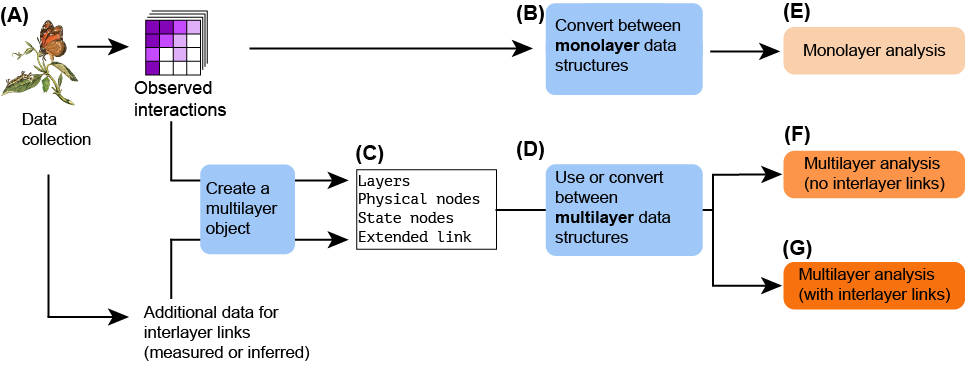

# About
This website contains complete examples for working with monolayer and multilayer network data with the package EMLN. It is rather self-explanatory but we recommend to read the paper **PROVIDE A TITLE/DOI** to really understand it. The general workflow is described in the figure below. We start with monolayer networks, which are the basis for handling multilayer networks. Our paper and this website focus on handling data (A-D in the figure) and not on analysis.



# Do I need anything to get started?
We assume at least some basic experience with monolayer network analysis and familiarity with the basic concepts of EMLNs. This is a technical reference. However, knowing the concept and theory is highly recommended when analyzing networks. Some recommended reading:

* Pilosof2017-zh,
* Hutchinson2019-wr
* De-Domenico 2013

We also recommend this [visual guide by Manlio De Domenico](https://github.com/manlius/muxViz/blob/master/gui-old/theory/README.md)

# Citing this website
Please cite...

# Installation
The EMLN package was built under R 4.1.0 and requires `magrittr, dplyr, ggplot2, stringr, tibble, tidyr, rlang, igraph, vegan`. The package is installed directly from GitHub.

```{r eval=FALSE, include=TRUE}
devtools::install_github('Ecological-Complexity-Lab/emln_package', force=T)
library(emln)
```

