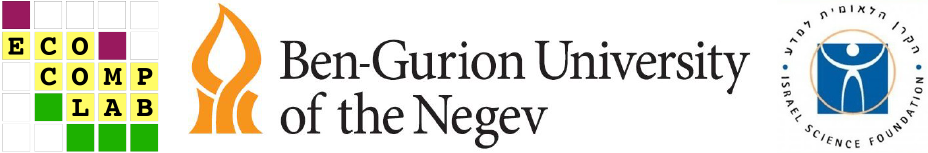

# About
The package and this website were developed by Noa Frydman, Itamar Talpaz, Shirly Freilikhman and Shai Pilosof, in the [Ecological Complexity Lab](http://www.bgu.ac.il/ecomplab), in Israel.

The R package code is available on GitGub here: [https://github.com/Ecological-Complexity-Lab/emln](https://github.com/Ecological-Complexity-Lab/emln)

# Grants
This work was supported by a research grant from Israel Science Foundation (1281/20), titled: "Ecological multilayer networks: advancing theory and methodology for understanding the complexity of ecological systems", awarded to Dr. Shai Pilosof.

# Feedback
We welcome any feedback on the paper and this website! The best way to provide feedback is to open an issue on the GitHub repository of the package: [https://github.com/Ecological-Complexity-Lab/emln/issues](https://github.com/Ecological-Complexity-Lab/emln/issues).

___

```{r out.height="80px", out.extra='style="float:left, padding:10px"', echo=FALSE}

```


